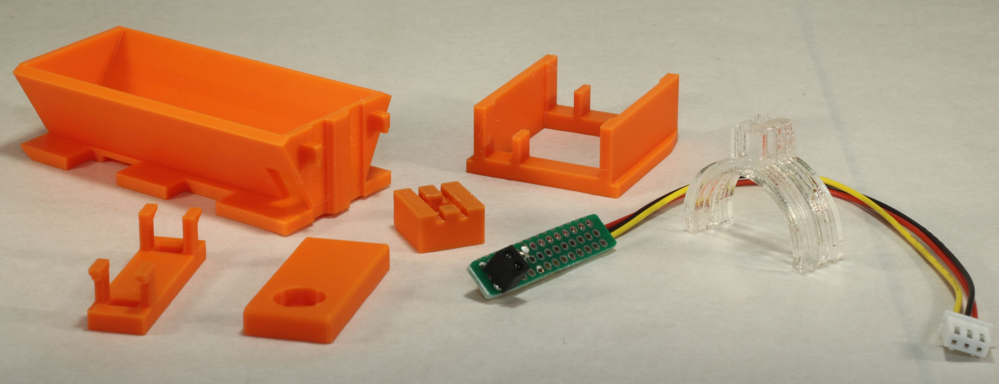

# 3D-Printed-Parts-for-NW2

Freecad files and related STL's which you should be able to send directly to your slicer and 3D printer are included in the NW2 Prints directory.

.

From left to right the five printed parts (all orange)  are  1) the battery holder,  2) battery holder retainer,  3) charging connector retainer,  4)  power on switch at base of smoke stack retainer, and 5)  electronics support.

The semicircular clear acrylic clip was cut on a laser printer.   It's made from a glue-up of four 1/8" thick pieces.  The diameter of the semi-circle needs to match the diameter of the can motor it wraps around.

An article on this effort appears in the January 2027 issue of Model Railroader Magazine (https://www.trains.com/mrr/) .  It's strongly recommended you see the article to better place the items depicted here in perspective.

