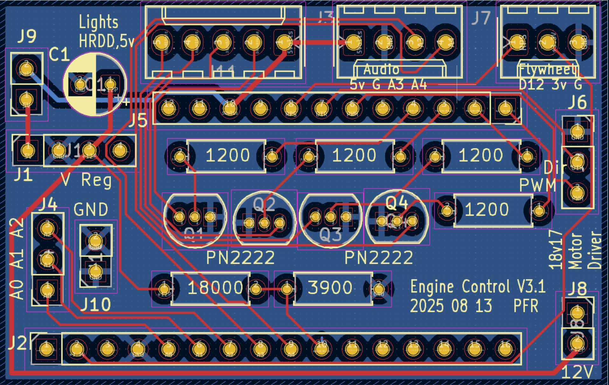

# Engine-control-module
The files here define a complete working circuit board.  It fits on top of an Adafruit Feather M0 with RFM69HCW 433MHz Packet Radio ( https://www.adafruit.com/product/3177 ).  Together they define the electronics needed to control a two can motor engine, lights, speed control (including cruise), direction and audio. In mid-2025 it cost me $7.00 per board to have the circuit board fabricated at OSHPark.  Tariffs have probably elevated the price.

.

An article on this effort appears in the January 2027 issue of Model Railroader Magazine (https://www.trains.com/mrr/).  It's strongly recommended you see the article to better place the items depicted here in perspective.

