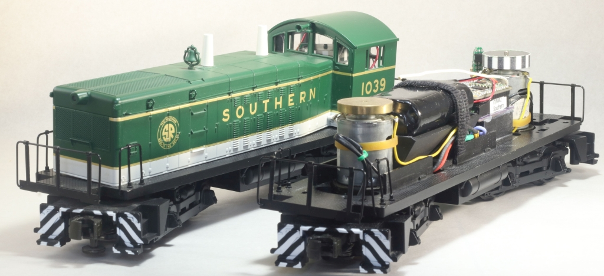

# Model-Train-Engine-Control
If you're a DIYer who enjoys model trains and hobbyist level electronics, and would like to convert your model train engines to radio control and battery power, then this material is for you.  The novelty in this work is that it's the first time I'm aware of that someone has fit all electronics AND a decent sized battery into a single O scale engine.  Other solutions I'm aware of place the battery in a separate platform (e.g. box car or coal car).

.

Code and other material here was created by me to convert my O scale engines to radio control and battery power.  Seen above is a 1999 MTH NW-2 (https://www.mthtrains.com/products/30-2157-1), one of my smaller engines, with control logic I created and LiPo battery power that can run the engine for hours.  With this accomplishment I'm certain the remainder of my O scale engines can be converted similarly.  There's enough information here to support your doing the same kind of conversions: all of my supporting code, KiCAD design files for a custom PCB, and FreeCAD  design files for 3D printed parts.  

An article on this effort appears in the January 2027 issue of Model Railroader Magazine (https://www.trains.com/mrr/).  I strongly recommend reading it to gain further insight.

